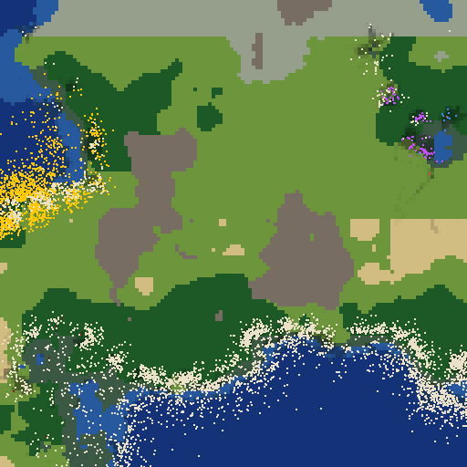

# Evolution MMO

A persistent multiplayer world where each player designs a founding organism
and steers its lineage through breeding rather than direct editing. The full
design is in [`docs/game-design.md`](docs/game-design.md).

This repository is at **build step 1** of that design: prototype the
simulation rules (genetics, needs, terrain) headless, with no players attached,
and measure per-organism tick cost before building the server.



## Layout

```
crates/
  sim/       evo-sim: the rules engine (library, no I/O)
  sim-cli/   evo-sim binary: run worlds, print reports, benchmark, render PNGs
docs/
  game-design.md
```

### `evo-sim` modules

| Module | Design-doc section | What it does |
| --- | --- | --- |
| `genome` | Scoring, Genetics | 38 diploid genes (body, behavior *and* mate preference). Every allele carries an origin tag: founders get the designer's ID, mutations get the owner of the organism they appear in, and tags never change. Expression is additive except for a per-gene dominance coefficient `h` (`expressed = mean + h·|a−b|/2`): coloration and fur are partly dominant, camouflage partly recessive. Four hidden load loci carry harmful recessives that arise by mutation, pass with their origin tags (and count for legacy), do nothing in carriers and harm homozygotes, so inbreeding exposes them and outcrossing hides them; `Genome::set_load` plants one in a founder or stud. |
| `design` | Organism design | Founder designs: thermoregulation → birth type → offspring count → traits, on a 100-point budget. Founders vary around the design. |
| `stats` | Stats layer, Derived physical properties | Phenotype → speed, strength, perception, stealth, metabolism… and height, weight, ground pressure, buoyancy, wing loading, grip. Thermoregulation mismatch (fur on a cold-blooded body blocks basking). |
| `terrain` | Seasons and biomes, Movement and terrain | Noise-generated biomes, latitude/altitude climate, four seasons, day/night. Rivers carved by flow accumulation down a pit-free drainage network to lakes, sea or map edge. Regional weather on a 16-tile grid: fronts drifting east bring wind, storms (chill, costly open ground, grounded flyers) and rain or snow; slow dry and wet spells and the seasons drive a per-cell soil wetness that fills and drains shallow lakes, marsh and rivers (droughts dry them out, crowding organisms at the rest) and paces plant regrowth; spring snowmelt swells rivers so fast deep water blocks weak swimmers, and rivers freeze in winter. Canopy browse needs height or climbing, and climbers in canopy are safe from ground hunters. Tiles update chunk by chunk, each chunk once per simulated hour. Hooks: `Map::weather_at`, `Tile::wetness`/`Map::dryness_at`, `Map::drought`/`flood`, `Map::terrain_version`/`chunk_version`. `traverse()` returns Blocked / Passable{speed, energy} from body vs. tile. |
| `pathfinding` | Movement and terrain | Bounded A* over tiles for one body: blocked tiles are avoided, slow ones cost time. Used only when the direct step is blocked (see Movement below). |
| `mating` | Override cost | Root-sum-of-squares preference mismatch, `cost = k·max(0, mismatch−1)²`, outbreeding depression by genetic distance, and sterility between different body plans (thermoregulation, birth mode, body size or diet more than 0.3 apart; `cargo run --release --example distances` prints the founders' matrix). Display coloration is condition-dependent (an honest signal). |
| `group` | Critical-mass group traits | Daily regional carrier frequency → logistic benefit. Implemented: cooperative hunting, warning coloration, herd defense, alarm calls. |
| `legacy` | Scoring: genetic legacy | Share of origin-tagged alleles among living breeding adults, raw and weighted by offspring raised to adulthood. |
| `world` | Needs and behavior, everything else | The tick loop: utility-AI decisions (parallel), then movement, grazing, hunting, scavenging, drinking, courtship, pregnancy, eggs and incubation, nursing, growth, death. |
| `world::disease` | Genetics: picky vs flexible | Mating-transmitted disease: pathogens emerge at matings (4× between founding lineages), pass between mates (natural and directed) and between nursing mothers and young, drain the acutely sick's health (dulling their display) and cut fertility; infections end in immunity or lifelong symptomless carriage. Also deaths of homozygotes for harmful recessives. Reports count infections, current sick and carriers, harmful alleles per organism, and `disease` / `recessive` deaths per lineage. |
| `world::commands` | Player controls | Directed matings (consent, meeting distance, seasonal slots, override cost), possession, migration orders. |

### Tick structure

1. **Hourly:** regional weather, egg incubation. **Every tick:** a share of the environment chunks (temperature, snow, ice, water levels, plant regrowth), so each chunk updates once per hour; the water-distance field is refreshed hourly.
2. **Daily:** remove the dead, recompute group traits, take a legacy snapshot, reset mating slots at a season change.
3. **Decide (parallel, read-only):** each organism scores actions by need urgency × its behavior genes.
4. **Apply (sequential, shuffled):** act on the decision, update needs, resolve death and birth.

Every random draw comes from a `(seed, stream, tick, organism)` stream, so a
run reproduces exactly from its seed regardless of thread count (there is a
test for this).

### Movement

Organisms steer straight at their target. When the direct step is blocked
(lake, cliff, a concave shore), the walker plans a route with A* for its own
body (`terrain::traverse`: swimmers cross deep water, climbers cliffs, ice
holds bodies light enough for its thickness), keeps it on the organism, and
follows it until it arrives, the target moves away from the route's goal,
it is pushed off the route, or the tile ahead closes (ice melts). Searches
expand at most `path_nodes` tiles (a search that runs out heads for the tile
it got closest to); a failed search isn't repeated for the same target until
the terrain changes on the hour, and a target out in water with no shore
next to it fails at once. Planning happens in the sequential apply phase,
so runs stay thread-count independent. Short sprints (fleeing, the last
lunge at prey) stay greedy. `--set path_nodes=0` restores greedy steering
exactly.

`cargo run --release --example stuck -- 120 1 2 3` measures how often
organisms are stuck: heading for the same reachable spot for 24 ticks
without getting 0.5 tiles closer. Over a year on three 128×128 seeds:

| | Stuck (share of ticks heading somewhere) | Worst lineages | Not moving at all |
| --- | --- | --- | --- |
| Greedy steering | 0.24% | burrowers 1.34%, voles 0.94% (one seed each) | 0.10% |
| Pathfinding | 0.03% | burrowers 0.21%, voles 0.10% (one seed each) | 0.01% |

Most of the remaining "stuck" ticks are the metric's blind spots (a detour
around a lake doesn't shorten the straight-line distance; targets thrash
between nearby spots). The benchmark runs about 0.75 searches per tick, and
its cost is unchanged within noise (callgrind: +0.2% instructions in total).

## Running

Needs a recent stable Rust.

```sh
cargo test --release                                  # unit and world tests
cargo run --release --bin evo-sim -- designs          # sample designs and point costs
cargo run --release --bin evo-sim -- run --days 120 --report 10 --snapshot out/world
cargo run --release --bin evo-sim -- bench --scale 4 --days 3
cargo run --release --bin evo-sim -- sweep --trials 16 --seeds 3 --rounds 2 --out sweep.csv
cargo run --release --bin evo-sim -- run --set sprint=2.0 --set crowding=0.05   # try a balance tweak
cargo run --release --example trace -- 3 200          # follow one fox (lineage 3)
cargo run --release --example stuck -- 120 1 2        # how often organisms get stuck
```

`run` founds a wild ecosystem (voles, antelope, newts, foxes) plus four sample
player lineages (pack hunters, herd grazers, toxic frogs, burrowing
omnivores), then prints population, legacy share, deaths by cause, active
group traits and gene drift per lineage.

## Benchmark (first measurement)

On a 4-core container, 128×128 map, ~1,700 organisms:

| Threads | ms per tick | µs per organism-tick |
| --- | --- | --- |
| 1 | 4.3 | 2.6 |
| 4 | 2.2 | 1.35 |

The single-thread figure falls within the design doc's 2–5 µs estimate. Only
the decision phase runs in parallel so far, which is why 4 threads give about
1.9×. Parallelizing the apply phase by region is the obvious next speed-up.
The later nearest-first perception scan brought the single-thread cost to
about 1.5–1.6 µs per organism-tick on the same benchmark.

## Balance

Ecosystem rates live in `Balance` (`crates/sim/src/config.rs`) and can be
overridden from the command line with `--set NAME=VALUE`. `evo-sim sweep`
tunes them by random search: each round perturbs every parameter of the
current best, runs every trial on several seeds in parallel, and recenters on
the winner with half the spread.

A run's score (max 12) gives each of the 8 lineages 1 point for surviving the
year and up to 0.5 for holding its founding size, minus up to 3 for time spent
pinned at a population cap. Per-species births and deaths by cause are in
every `run` report.

Validation uses 12 seeds (31–42) that no tuning run or agent touched, on a
96×96 map for 120 days:

| | Score | Vole | Antelope | Newt | Fox | Pack hunters | Herd grazers | Toxic frogs | Burrowers |
| --- | --- | --- | --- | --- | --- | --- | --- | --- | --- |
| Original rules (first sweep, 3–4 seeds) | 6.5 | 100% | 100% | 100% | 0% | 0% | 100% | 100%, capped | 75% |
| After the first tuning sweep (3 seeds) | 9.3 | 100% | 100% | 100% | 100% | 67% | 100% | 100%, capped | 67% |
| Greedy steering (12 unseen seeds) | 11.3 | 100% | 83% | 100% | 100% | 92% | 92% | 100% | 100% |
| **Current: pathfinding (12 unseen seeds)** | **11.1** | 100% | 67% | 100% | 100% | 100% | 92% | 100% | 92% |

Pathfinding cost 0.2 points, within the noise of a no-op change (`sprint`
2.45 → 2.4501 under greedy steering scores 11.04 with antelope at 67%).
Mean numbers lean toward predators: voles 257 → 188, newts 252 → 179, frogs
417 → 337, herd grazers 40 → 19, foxes 54 → 64, pack hunters 20 → 30.
Deaths by cause on single seeds show no consistent mechanism yet (predation
up on one of three, down on another), so judge it on more seeds before
retuning.

Toxic frogs now average about half their cap instead of sitting at it, and no
lineage spends the run pinned at a cap.

Almost all of the gain came from rule bugs that per-species birth and death
statistics exposed, not from tuning numbers:

| Problem | Fix |
| --- | --- |
| Exhausted predators kept chasing and starved at a crawl | Rest before hunting; ambush bonus vs. unaware prey |
| Predators kept eating toxic frogs and dying | One poisoning by bright prey teaches avoidance |
| Hundreds of voles drowned | Newborns and steps never land on tiles the body can't use |
| Wandering targeted unreachable tiles (deep water), stranding predators at shores | Wander only to enterable tiles |
| Voles and newts interbred (and foxes with pack hunters) | Different body plans (endothermy, birth mode, size, diet) are sterile |
| Foxes treated voles as kin and wouldn't hunt them | Kin recognition also requires a compatible body plan |
| Only the first 48 neighbors were seen, in arbitrary order, so crowds hid predators | Nearest-first scan with exact pruning (also ~15% faster) |
| A strike almost always killed: no contest of speed or agility | Alert prey can slip a strike and bolt (`escape`, `escape_window`) |
| Burrowers fled in the open instead of going to ground | Threatened burrowers hide; attacks on sheltered burrowers mostly fail |
| Calves died in their first days; mothers couldn't defend them | Nearby mothers add their defense; threatened calves run to them |
| Predators hunted other predators as freely as prey | Prey that fights back is weighed as injury risk and hurts attackers |
| Fast breeders (frogs, newts, voles) pinned their caps | Larval competition, pace-of-life adult mortality, density-dependent breeding |
| Wild species shared one cap, so voles took the newts' room | Wild cap split per species |
| Founders could start beside predators or with water behind them | Placement keeps a predator buffer and needs safely reachable water |

A final 32-trial sweep over all 28 parameters (seeds 1–6) found nothing that
beat the current defaults on the unseen seeds (11.07 vs 11.29), so the
defaults stayed as they are.

Dominance, hidden recessives and mating-transmitted disease (defaults in
`Balance`) score 11.06 on the same 12 seeds (dominance alone 11.02): within
the seed-to-seed chaos, antelope 67%, pack hunters 100%, herd grazers 83%,
all else 100%. At the defaults disease is endemic but rare (tens of
infections per world, a handful of deaths) and harmful recessives reach about
0.05 per organism in a year; disease and recessive draws use their own random
stream, so they change a world only through their effects.

**Still open:**

- Single worlds are chaotic: changing one parameter in the fourth decimal
  place can flip which marginal lineage survives. Judge changes by survival
  across many seeds, never one.
- Antelope and herd grazers are the weakest lineages now that every predator
  is viable (mean alive ~20 and ~40). Hybrids between those two
  near-identical designs still occur, as do fox × pack hunter hybrids, since
  those pairs share a body plan.
- A 12-seed, 120-day validation takes about 35 seconds on 4 cores.

Not yet implemented from the design doc: the other five group traits, seasonal strategies
(hibernation, migration, estivation as genes), level-of-detail statistical
populations. On the environment side: rivers do not overflow onto
their floodplain (flooding only deepens the channel), wind has no direction
and does not interact with wing loading or gliding, and lakes do not form in
filled depressions. The point costs in `design.rs` are placeholders, as the
doc lists them as an open question.

## Suggested next steps

1. **Slow breeders under predation:** antelope and herd grazers are now the
   weakest lineages (sub-adults and orphans are the main losses).
2. **Sweep robustness:** score trials on more seeds (single worlds are
   chaotic), and screen trials on short runs before giving the best full runs.
3. Parallel apply by region, then measure at the doc's prototype target
   (~25k organisms on 256×256).
4. Seasonal strategies as genes, then the remaining group traits.
5. Step 2 of the build order: the Tokio/Axum server around `World`, using
   `world::commands` for player actions.
